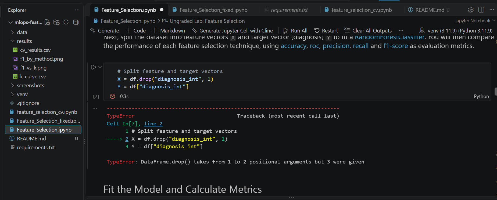
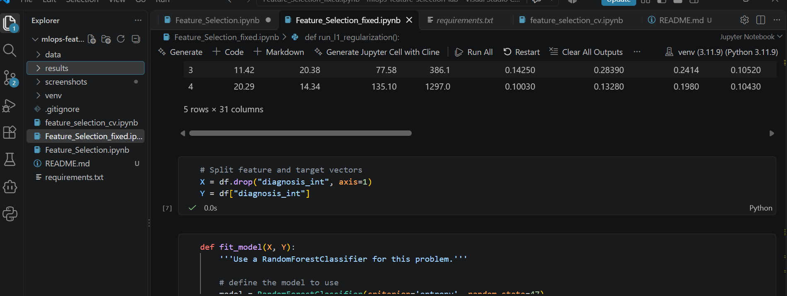
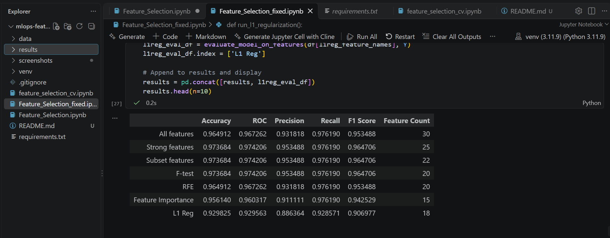
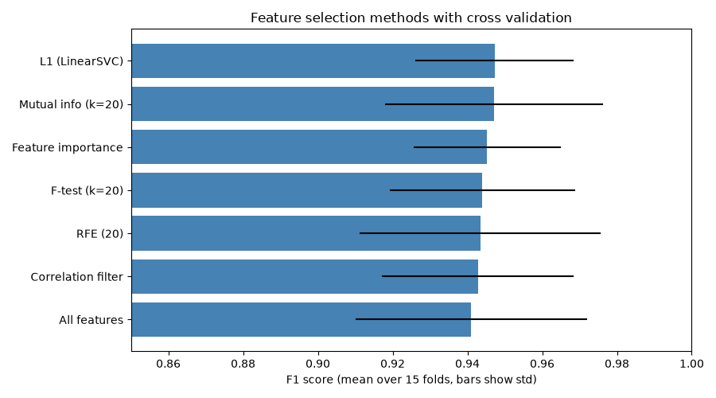
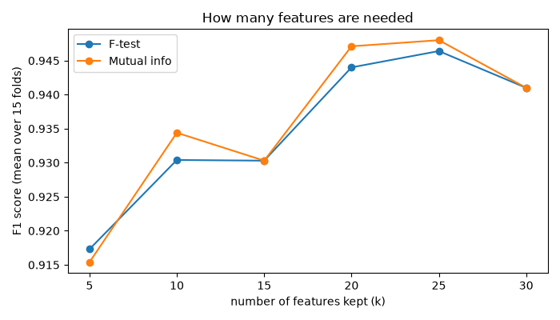

# Feature Selection Lab: Cross Validated Feature Selection

This is my submission for the Feature Selection lab from the course repo (Labs/Model_Development/Feature_Selection). The lab uses the breast cancer dataset (569 patients, 30 measurements each, diagnosis malignant or benign) and compares different ways of choosing which features to keep before training a random forest.

The original notebook tries six feature selection methods and scores each one on a single 80/20 train/test split. When I ran it, I found that it no longer runs on current pandas, and that the way it compares methods is not reliable. My work fixes the notebook so it runs, then rebuilds the comparison so that feature selection is done properly and the results can be trusted.

## Problems I found in the original notebook

1. **It does not run on current pandas.** It was written for an older pandas (the notebook metadata says Python 3.9). Three things it uses were removed in pandas 2:
   1. `df.drop("diagnosis_int", 1)` now needs `axis=1`. This is the first error you hit:

   

   2. `.iteritems()` is now `.items()`.
   3. `results.append(...)` no longer exists and has to be replaced with `pd.concat`.
2. **The comparison is mostly noise.** The test set is only 114 patients. In my run of the fixed notebook, the accuracies were 0.9649 and 0.9737 for most methods. That difference is exactly one patient (110 vs 111 correct out of 114). The notebook calls this an improvement, but it comes from one lucky split.
3. **Data leakage in the correlation filter.** It calculates the correlation with the target on the whole dataset, including the test rows, and then uses that to pick features.
4. **ROC AUC is calculated from 0/1 predictions** instead of predicted probabilities, so it does not really measure ranking quality.
5. **The feature importance method is not reproducible.** It uses `RandomForestClassifier()` with no random seed, so its selected features and score change every run.
6. **Correlated features are removed by hand** after looking at a heatmap (radius_worst, perimeter_worst and area_worst), so the step cannot be repeated on new data.

## What I changed

### 1. Feature_Selection_fixed.ipynb

A copy of the original with only the pandas fixes above (`axis=1`, `.items()` and `pd.concat`). Nothing else is changed, so it gives the original lab's results on current packages. The original Feature_Selection.ipynb is kept unchanged in the repo.



My results from the fixed notebook (single split):

| Method | Accuracy | ROC | F1 Score | Features |
|---|---|---|---|---|
| All features | 0.9649 | 0.9673 | 0.9535 | 30 |
| Strong features | 0.9737 | 0.9742 | 0.9647 | 25 |
| Subset features | 0.9737 | 0.9742 | 0.9647 | 22 |
| F-test | 0.9737 | 0.9742 | 0.9647 | 20 |
| RFE | 0.9649 | 0.9673 | 0.9535 | 20 |
| Feature Importance | 0.9561 | 0.9603 | 0.9425 | 15 |
| L1 Reg | 0.9298 | 0.9296 | 0.9070 | 18 |



The Feature Importance row will be a bit different every time this notebook is run, because of the missing random seed (problem 5).

### 2. feature_selection_cv.ipynb (my main changes)

1. **Every selection method runs inside a scikit-learn Pipeline** (scale, select features, random forest). Feature selection is fit again inside each fold, so it only ever sees training data. This removes the leakage from problem 3.
2. **Repeated stratified cross validation** (5 folds, 3 repeats, so 15 runs) instead of one split. I report the mean accuracy, mean F1, the standard deviation of F1, and ROC AUC calculated from predicted probabilities. This fixes problems 2 and 4.
3. **A new CorrelationSelector class** that does the two correlation steps of the original automatically: it keeps features with correlation above 0.2 with the target, then drops any feature that has correlation of 0.9 or more with a feature already kept. This replaces the manual step in problem 6.
4. **A new method: mutual information** (SelectKBest with mutual_info_classif, k=20), which can also pick up relationships that are not linear.
5. **Fixed random seeds everywhere**, including the random forest used for feature importance and the mutual information scores, so every run gives the same result. This fixes problem 5.
6. **A stability check** that counts how many features each method picked in all 15 folds, to show whether a method chooses the same features every time.
7. **A curve of F1 against the number of features kept (k)** for the F-test and mutual information, to see how many features are actually needed.
8. **Results are saved** to the results folder: cv_results.csv, k_curve.csv, f1_by_method.png and f1_vs_k.png.

The model and settings are the same as the original (random forest with criterion entropy and random_state 47, k=20, threshold 0.013, LinearSVC with C=1 and L1 penalty), so the only things that change are how features are selected and how the methods are evaluated. I only added `max_iter=5000` to LinearSVC to stop a convergence warning.

## What you need to install

1. **Git**: download from https://git-scm.com and install with the default options.
2. **Python 3.11**: I used Python 3.11.9. Download it from https://www.python.org/downloads/ (look under "All releases" for 3.11.9). On Windows, tick "Add Python to PATH" on the first screen of the installer.
3. **VS Code** (to run the notebooks): download from https://code.visualstudio.com and install the "Python" and "Jupyter" extensions from the Extensions tab. If you prefer Jupyter in the browser, run `pip install notebook` after the setup below and then `jupyter notebook`.

## Setup

1. Clone the repo and go into the folder:

```
git clone https://github.com/bpaduru/mlops-feature-selection-lab.git
cd mlops-feature-selection-lab
```

2. Create and activate a virtual environment.

On Windows:

```
py -3.11 -m venv venv
venv\Scripts\activate
```

On Mac or Linux:

```
python3.11 -m venv venv
source venv/bin/activate
```

You should see `(venv)` at the start of the terminal line. If Windows PowerShell says running scripts is disabled, run `Set-ExecutionPolicy -Scope CurrentUser RemoteSigned`, type Y, and try again.

3. Install the packages:

```
python -m pip install --upgrade pip
pip install -r requirements.txt
```

The main versions I used are pandas 3.1.1, numpy 2.4.6, scikit-learn 1.9.1, matplotlib 3.11.2, seaborn 0.13.2 and ipykernel 7.4.0. The pandas version matters: the original notebook fails on pandas 2 or newer, which is why the fixed copy is needed.

## How to run

1. Open the repo folder in VS Code.
2. Open `Feature_Selection_fixed.ipynb`, click "Select Kernel" at the top right, choose the venv environment, then click "Run All". This takes a few seconds.
3. Open `feature_selection_cv.ipynb`, select the same kernel, and click "Run All". This takes about one to two minutes. The cell that runs all seven methods takes the longest because of RFE, and the k curve cell takes about 30 seconds.

The data file is already in the repo at data/breast_cancer_data.csv, so nothing needs to be downloaded.

## What a successful run looks like

`Feature_Selection_fixed.ipynb` finishes with the results table shown above.

In `feature_selection_cv.ipynb`:

Cell 2 prints the data shape and class counts:

```
(569, 30)
0    357
1    212
```

Cell 5 prints `done:` for each method, then the cross validated results sorted by F1:

```
                    avg_features  accuracy      f1  f1_std  roc_auc
L1 (LinearSVC)           19.0667    0.9613  0.9473  0.0212   0.9922
Mutual info (k=20)       20.0000    0.9613  0.9471  0.0292   0.9891
Feature importance       15.4667    0.9596  0.9453  0.0197   0.9905
F-test (k=20)            20.0000    0.9590  0.9440  0.0248   0.9900
RFE (20)                 20.0000    0.9590  0.9434  0.0322   0.9901
Correlation filter       15.8667    0.9584  0.9428  0.0257   0.9929
All features             30.0000    0.9572  0.9410  0.0310   0.9902
```

The last digit of the L1 row can be slightly different on another computer.

Cell 6 shows the F1 chart with error bars:



Cell 7 prints how many features each method picked in all 15 folds:

```
All features          30
Correlation filter    14
F-test (k=20)         19
Mutual info (k=20)    18
RFE (20)              15
Feature importance    14
L1 (LinearSVC)         6
```

Cell 8 prints the k curve and cell 9 plots it:

```
    F-test  Mutual info
k
5   0.9173       0.9154
10  0.9304       0.9344
15  0.9303       0.9303
20  0.9440       0.9471
25  0.9464       0.9480
30  0.9410       0.9410
```



After running, the results folder has cv_results.csv, k_curve.csv, f1_by_method.png and f1_vs_k.png.

## Results and observations

1. **With cross validation, all methods are basically tied.** The F1 scores go from 0.9410 (all features) to 0.9473 (L1), a gap of about 0.006, while the standard deviation of F1 across folds is between 0.02 and 0.03 for every method. The error bars in the chart overlap a lot, so none of the methods is clearly better than the others on this dataset.
2. **The single split gave a misleading ranking.** On the single split, L1 was the worst method (F1 0.9070). With cross validation it came out first (F1 0.9473). This shows how much one 114 patient test set can mislead a comparison.
3. **Fewer features work just as well.** The correlation filter and feature importance use about 15 to 16 features on average and score the same as using all 30. Removing half of the features does not hurt the model.
4. **L1 is the least stable.** Only 6 features were picked by L1 in all 15 folds, compared to 14 to 19 for the other methods. It scores well but chooses a different set of features almost every time, which matters if you need to explain which features the model uses.
5. **About 20 features are enough.** The k curve rises from about 0.917 at 5 features to about 0.947 at 20 to 25 features, then drops a little to 0.941 with all 30 features.

## Files in this repo

Feature_Selection.ipynb is the original lab notebook, unchanged.
Feature_Selection_fixed.ipynb is the original with only the pandas fixes.
feature_selection_cv.ipynb is my notebook with all the changes described above.
data/breast_cancer_data.csv is the dataset from the original lab.
results/ has the saved results and charts from my notebook.
screenshots/ has the screenshots used in this README.
requirements.txt has the package versions I used.
